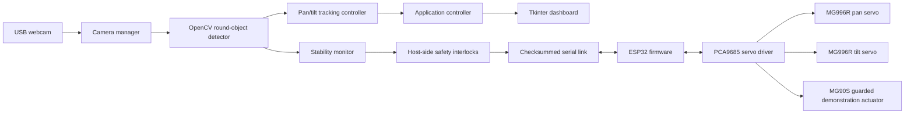

# ORION — Object Recognition and Intelligent Observation Network 🤖

**Author:** Vivek Vishwakarma  
**Project type:** AI + Computer Vision + Embedded Robotics prototype  
**Status:** Research/prototype software; not yet validated on real hardware.

ORION integrates a USB webcam, Python/OpenCV vision processing, a 2-DOF pan/tilt camera head, and an ESP32-controlled PCA9685 servo driver. The default detector searches for round objects of different colours; a legacy red-object detector is also included. The desktop application provides live camera status, tracking, stability monitoring, serial telemetry, and safety-state visibility.

> **Important safety and verification notice**  
> The uploaded wiring reference omits the PCA9685 OE handling and physical emergency-stop wiring expected by the supplied firmware. **Do not power or enable the servos/actuator using that incomplete wiring as-is.** Add and verify a hardware power-cut emergency stop and the required OE circuit, check power/ground/current ratings, and commission the actuator with no popping element fitted. Never use sharp projectiles or expose moving parts. The software and firmware have not been verified on the author's physical hardware; check every hardware-specific assumption before use.
## ## 🎥 Project Demo

Watch ORION in action: https://lnkd.in/p/dnT8Pta8
## Features

- Round-object detection using Python, OpenCV, and NumPy.
- Legacy HSV-based red-balloon detector.
- 2-DOF pan/tilt tracking controller with configurable limits.
- ESP32 serial protocol with checksums, sequence numbers, heartbeat, and telemetry.
- Stability monitoring and host-side interlocks.
- Tkinter desktop control panel with camera/serial status and event logging.
- Configuration through `config.py` and optional `config.json`.

## Hardware

- ESP32 development board (USB data connection to laptop)
- USB webcam SENSOR 
- PCA9685 16-channel servo driver
- 2 × MG996R servos for pan and tilt
- 1 × MG90S servo for a guarded, stationary, blunt demonstration actuator
- Separate, appropriately rated servo power supply/battery, fuse, and common ground
- **Required safety additions:** physical emergency-stop power cut and appropriate PCA9685 OE handling, implemented and verified before servo commissioning

Do not power servos from the ESP32 3V3 pin. Size the supply, wiring, connectors, fuse, and capacitor for the actual stall-current requirements of the servos. Verify the PCA9685 logic and servo-power rails against the board documentation.

## Repository structure

```text
ORION/
├── main.py                         # App entry point and processing/control orchestration
├── config.py                       # Dataclass configuration and validation
├── camera_manager.py               # Threaded webcam capture and FPS measurement
├── round_object_detector.py        # Colour-agnostic round-object detector (default)
├── red_balloon_detector.py         # Legacy red-HSV detector and overlay helpers
├── tracking_controller.py          # Pan/tilt tracking calculations and limits
├── stability_detector.py           # Centering/stability timing logic
├── serial_communication.py         # Framed serial protocol and telemetry
├── safety_manager.py               # Host-side interlocks and application state
├── gui.py                          # Tkinter dashboard
├── requirements.txt                # Python dependencies
├── firmware/
│   └── esp32_servo_controller.ino  # ESP32/PCA9685 firmware supplied with the project
├── diagnostics/
│   ├── camera_test.py              # Webcam index/backend probe
│   └── serial_test.py              # Serial-port listing utility
├── docs/
│   ├── circuit_connections.md      # Wiring map and critical omissions
│   ├── testing_procedure.md        # Staged, low-risk validation checklist
│   └── troubleshooting.md          # Common setup issues
├── assets/
│   ├── wiring-reference.png        # Original wiring screenshot
│   └── orion-wiring.svg             # Simplified connection diagram
├── .gitignore
└── LICENSE
```

## Software setup (Windows)

1. Install Python 3.10–3.12 from the official Python distribution. Make sure Tcl/Tk is included.
2. Open a terminal in the repository folder and run:

   ```powershell
   python -m venv .venv
   .venv\Scripts\activate
   python -m pip install --upgrade pip
   pip install -r requirements.txt
   ```

3. Install Arduino IDE 2.x and the **esp32 by Espressif Systems** board package.
4. In Arduino IDE Library Manager, install **Adafruit PWM Servo Driver Library** (and its Adafruit BusIO dependency).
5. Open `firmware/esp32_servo_controller.ino`, select the matching ESP32 board and COM port, and compile. **Do not connect/enable the servo power stage until the safety wiring and firmware assumptions have been reviewed.**
6. Run `python diagnostics/camera_test.py` to find the external webcam index/backend.
7. Run `python diagnostics/serial_test.py` to list serial ports.
8. Create a local configuration if required:

   ```powershell
   python config.py --write config.json
   ```

   Edit the camera index and serial COM port for your own system. `config.json` is ignored by Git so local machine settings are not committed.

## Run the application

```powershell
.venv\Scripts\activate
python main.py --index 1 --backend MSMF --port COM5
```

Replace `1` and `COM5` with the values reported by your diagnostics. The application is intended to start disarmed with tracking disabled. Read the safety notes and the supplied code before connecting hardware.

## Architecture



## Important implementation notes

- The camera defaults, serial port, servo directions, pulse ranges, and angle limits are hardware-specific assumptions. Verify them with the real setup.
- The app's frame size is configured as 640×480 and must match the firmware constants.
- The round detector's score is a heuristic quality score, not a probability.
- The original source documentation says the code was checked using offline self-tests/simulations but was not run on real hardware. Real-hardware performance is therefore unverified.
- The supplied reference image is not a complete, safe wiring schematic. See [`docs/circuit_connections.md`](docs/circuit_connections.md).

## Potential research applications

- Intelligent observation and camera tracking
- Automated visual monitoring
- Industrial inspection prototypes
- Autonomous robotics education and research

## Author

**Vivek Vishwakarma** — project design and integration.

## License

MIT License; see [`LICENSE`](LICENSE). Third-party libraries remain under their respective licenses.
